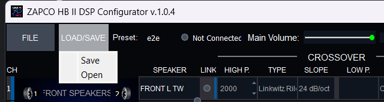
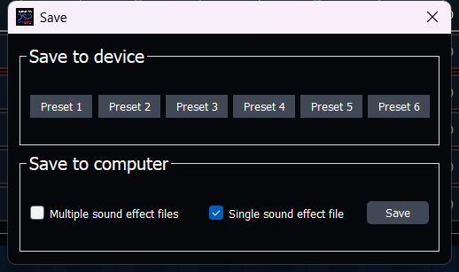
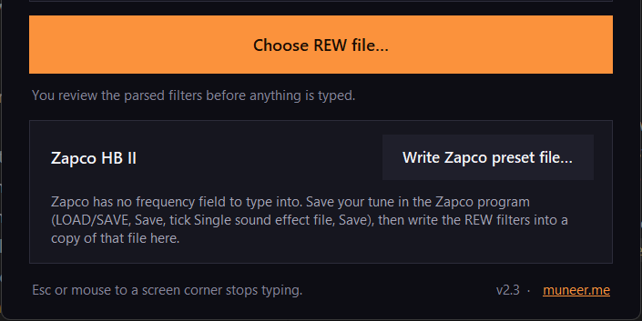
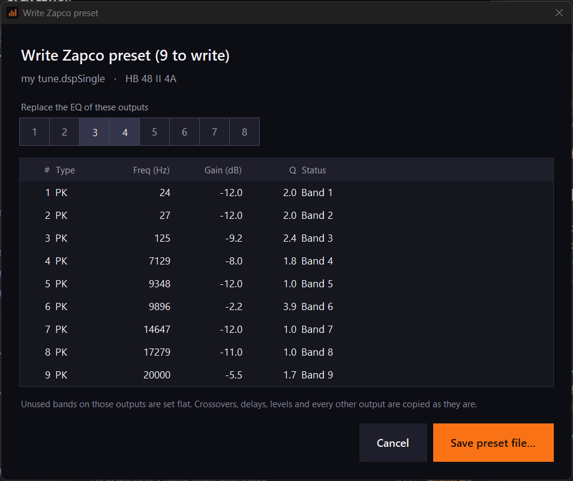
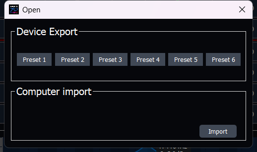
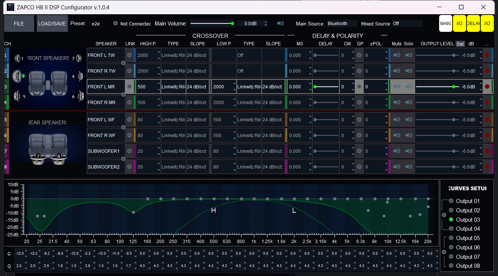

# Zapco HB II: putting REW filters into the Zapco DSP

For the Zapco HB 68 II, HB 46 II, HB 48 II, HB 410 II and HB 810 II.

Three names are used in this guide:

- **The Zapco DSP** is the Zapco unit in the car.
- **The Zapco program** is the Zapco HB II DSP Configurator on the PC, the one you use to tune the Zapco DSP.
- **The app** is REW → DSP Importer. For this job, the "DSP" in its name is the Zapco DSP.

The Zapco program has no box to type a frequency into, so the app cannot type the filters for you like it does for other DSPs. Instead the app writes the filters into a Zapco file, you open that file in the Zapco program, and the Zapco program sends them to the Zapco DSP. It takes about a minute per speaker.

## What you need

- The Zapco program open, with your crossovers, delays and levels already set.
- The REW filter file (`.txt`) for the speaker you want to EQ.
- The app (**REW → DSP Importer**), version 2.3 or newer.

## Part 1: Save your tune from the Zapco program

1. In the Zapco program, click **LOAD/SAVE**, then **Save**.

    

2. Under **Save to computer**, tick **Single sound effect file**, then click **Save**.

    

3. Give it a name you will recognise, for example `my tune`, and save it on the Desktop.

## Part 2: Add the REW filters in the app

1. Open the app and click **Write Zapco preset file…** in the **Zapco HB II** box near the bottom.

    

2. Pick the REW filter file (`.txt`).
3. Pick the Zapco file you saved in Part 1 (`my tune`).
4. Click the number of each output that should get these filters. The numbers are the same as the **CH** numbers down the left side of the Zapco program. For a left and right pair that use the same filters, click both.

    

5. Look through the list. Each row shows what will be written.
    - **Orange row**: the value was too big or too small for the Zapco DSP, so it was changed to the nearest value it allows.
    - **Grey row**: skipped. The Zapco DSP only takes normal peaking (PK) filters.
6. Click **Save preset file…**, then **Save**. The new file is saved next to your old one as `my tune + REW`. Your old file is not changed.

## Part 3: Open the new file in the Zapco program

1. Turn the volume down.
2. In the Zapco program, click **LOAD/SAVE**, then **Open**, then **Import**.

    

3. Pick the new file (`my tune + REW`).
4. Click the speaker's row and check the EQ graph at the bottom. You should see the filters from REW.

    

5. When you are happy with it, save it to the Zapco DSP: **LOAD/SAVE**, **Save**, then a **Preset** button under **Save to device**.

## Doing more speakers

Each REW file is for one speaker (or one left and right pair). To add the next one, do Part 2 again, but in step 3 **pick the newest file** (`my tune + REW`), not the first one. That keeps the filters you already added.

When all speakers are done, do Part 3 once with the last file.

## Good to know

- Only the EQ of the outputs you picked is replaced. Any bands not used by REW are set flat on those outputs.
- Crossovers, delays, levels and the other outputs stay exactly as they were in your saved file.
- The Zapco DSP allows 31 filters per output, gain from -15 to +6 dB, and Q from 0.5 to 15. To avoid orange rows, set the same limits in REW before it calculates the filters.
- The Zapco DSP stores whole numbers for frequency and one decimal for Q, so `63.5 Hz` becomes `64 Hz` and Q `1.41` becomes `1.4`.

## If something goes wrong

| What you see | What to do |
|---|---|
| "Not a Zapco preset" | Pick the file you saved from the Zapco program in Part 1. Make sure **Single sound effect file** was ticked when you saved it. |
| "No filters found" | The REW file is not a filter export. In REW, save the filter settings as a text file and pick that file. |
| "Pick another name" | You tried to save over your original Zapco file. Keep the suggested name or type a new one. |
| The EQ in the Zapco program looks wrong | Open your original file (`my tune`) again with **LOAD/SAVE**, **Open**, **Import**. Nothing is lost. |
